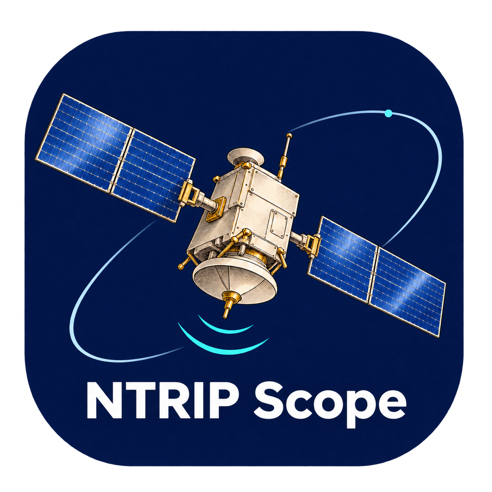
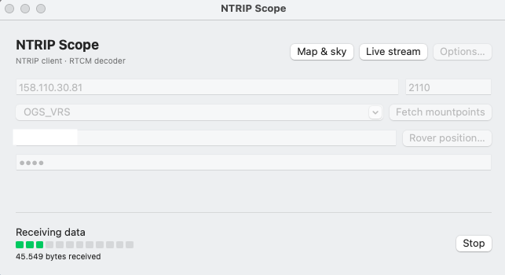
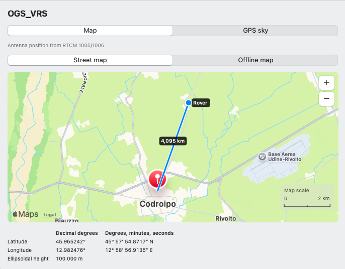
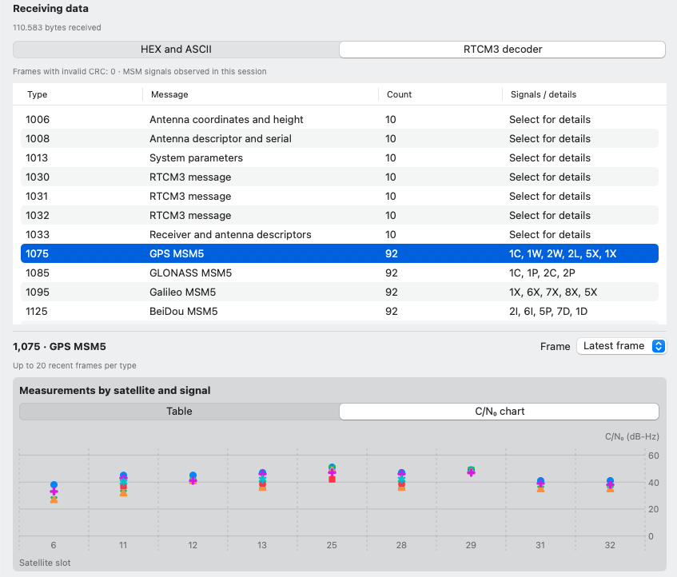
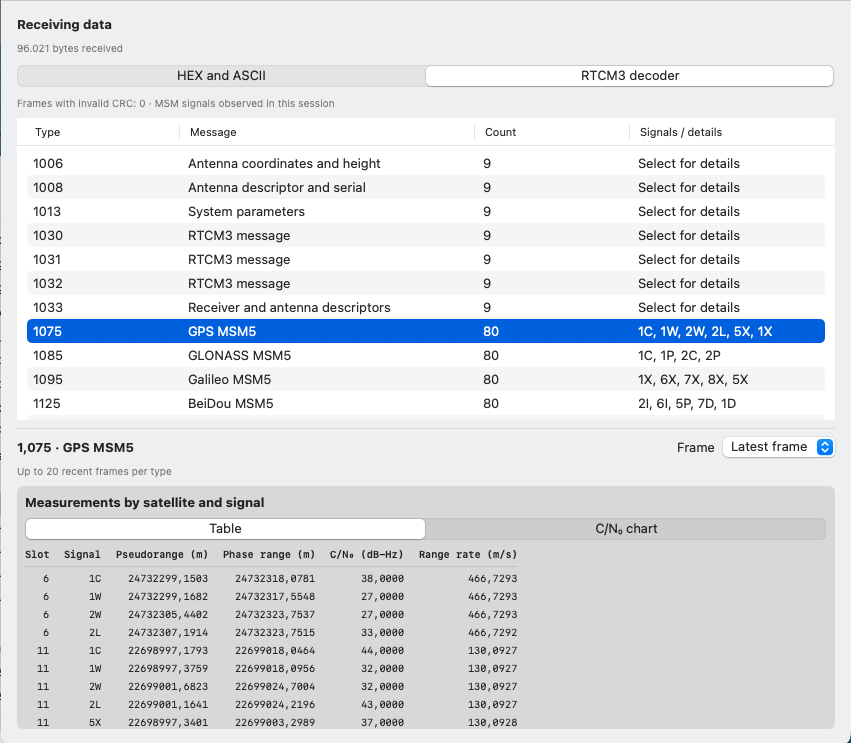

# NTRIP Scope



NTRIP Scope includes a graphical desktop client with a live RTCM3 decoder and a command-line client, `ntripscope`, for macOS, Windows and Linux. The desktop interface is available in English and Italian. The command-line client can list mountpoints and stream raw RTCM to standard output for scripting, or forward it to files, TCP and serial ports.

## Downloads

### Desktop client

Choose the package for your system from the [v1.10 release](https://github.com/zuliani71/NTRIP-Scope/releases/tag/v1.10). To use the desktop INI importer, [build version 1.11 from source](#build-and-test).

| Platform | Package |
|---|---|
| macOS 13+ on Apple Silicon | [Download macOS ARM64](https://github.com/zuliani71/NTRIP-Scope/releases/download/v1.10/NTRIP-Scope-macos-arm64.zip) |
| Windows x64 | [Download Windows x64](https://github.com/zuliani71/NTRIP-Scope/releases/download/v1.10/NTRIP-Scope-windows-x64.zip) |
| Linux ARM64 · Ubuntu in Parallels on Apple Silicon | [Download Linux ARM64](https://github.com/zuliani71/NTRIP-Scope/releases/download/v1.10/NTRIP-Scope-linux-arm64.tar.gz) |
| Linux x64 · Intel or AMD | [Download Linux x64](https://github.com/zuliani71/NTRIP-Scope/releases/download/v1.10/NTRIP-Scope-linux-x64.tar.gz) |

On Linux, run `uname -m` to check your architecture. Use ARM64 for `aarch64` and x64 for `x86_64`. The Linux binaries target Ubuntu 22.04 or compatible systems.

### Command-line client

Download [ntripscope.zip](https://github.com/zuliani71/NTRIP-Scope/releases/download/v1.10/ntripscope.zip)
and extract it on macOS, Windows or Linux. It requires Python 3.10 or later.
From the extracted folder, run:

```sh
python3 ntripscope.py --host caster.example.org --port 2101 --list
python3 ntripscope.py --config ntripscope-vrs.example.ini
```

The default output is binary RTCM on stdout. Use the repeatable `--file`,
`--tcp` and `--serial` options to forward the stream to multiple destinations.
See the [CLI guide and full INI syntax](src/portable/ntripscope.md), the
[basic example](src/portable/ntrip-scope.example.ini) and the
[VRS example](src/portable/ntripscope-vrs.example.ini).
Build a standalone executable on the target system with
`python src/portable/build.py --cli` after installing the build requirements.

## Screenshots

| Live NTRIP connection | Rover and mountpoint map |
| --- | --- |
|  |  |

| RTCM3 decoder and C/N₀ chart | Measurements by satellite and signal |
| --- | --- |
|  |  |

## Features

| Capability | Desktop client | Command-line client |
|---|---|---|
| NTRIP connection | NTRIP 1.0 and 2.0, authentication, TLS and mountpoint selection from the sourcetable | NTRIP 1.0 and 2.0, authentication, TLS and mountpoint listing with `--list` |
| Rover position for VRS | Decimal and sexagesimal coordinate entry with automatic conversion and periodic GGA | Decimal coordinates via arguments or INI and periodic GGA |
| RTCM outputs | Optional file, local TCP and serial outputs. Monitor with all outputs disabled | Raw binary RTCM on standard output by default. Repeatable file, TCP and serial destinations, with optional simultaneous standard output |
| Shared configuration | Import an INI from **Options → Load configuration…** in version 1.11 | Read an INI with `--config`. Command-line options override corresponding file settings |
| Stream inspection | Live HEX and ASCII, CRC checks, frame history, RTCM3 fields, MSM measurements and a C/N₀ chart | Raw stream for processing by scripts or external decoders. Status and errors go to standard error |
| Map and GPS sky | Separate windows with street and offline maps, scale, rover-to-mountpoint distance and GPS tracks when ephemerides are available | Headless operation for scripts and automated workflows |

The street map uses Apple Maps on macOS and OpenStreetMap on Windows and Linux. GPS tracks require broadcast RTCM 1019 ephemerides and a GPS MSM epoch.

## Share an INI configuration

Starting with version 1.11, the desktop app can load the same file used by `ntripscope --config`.
Choose **Options → Load configuration…** to populate the caster, mountpoint, credentials, rover coordinates for VRS, and file, TCP and serial outputs. Then choose **Connect** or **Fetch mountpoints**.
The CLI settings `stdout` and `list` apply only to command-line runs.
The macOS desktop app accepts multiple files, one TCP port and one serial device per session.
Use a serial device name appropriate for the system where the configuration runs.

## Source layout

| Directory | Contents |
|---|---|
| [src/macos/](src/macos/) | Native macOS app in Swift and its build script |
| [src/portable/](src/portable/) | Shared Windows and Linux desktop app and cross-platform command-line client in Python |
| [assets/](assets/) | Shared map, icon and localization files |

## Run from source

Use Python 3.10+ with Tk. On Debian/Ubuntu install `python3-tk` and `python3-venv`. On Windows, install Python with the Tcl/Tk option enabled.

```sh
python -m venv .venv
```

Activate the environment with `.venv\Scripts\Activate.ps1` on Windows PowerShell or `source .venv/bin/activate` on Linux. Then run:

```sh
python -m pip install -r src/portable/requirements.txt
python src/portable/app.py
```

On Linux, the account running the app needs access to the selected serial device. TCP output listens on `127.0.0.1` and supports one receiving client at a time.

## Build and test

Run these commands on the target operating system:

```sh
python -m pip install -r src/portable/requirements-build.txt
python -m unittest discover -s src/portable/tests -v
python src/portable/build.py
```

The executable appears in `dist/`. To rebuild the macOS archive on an Apple Silicon Mac with the Swift toolchain, run `sh src/macos/build.sh`.

## Credits

The portable decoder uses [pyrtcm](https://github.com/semuconsulting/pyrtcm), serial I/O uses [pySerial](https://github.com/pyserial/pyserial), and executable packaging uses [PyInstaller](https://pyinstaller.org/). The portable basemap is made with [Natural Earth](https://www.naturalearthdata.com/about/terms-of-use/) public-domain 1:110m land data, version 5.1.2. The portable street map uses [OpenStreetMap](https://www.openstreetmap.org/copyright) under its [tile usage policy](https://operations.osmfoundation.org/policies/tiles/).

## License

NTRIP Scope is distributed under the [MIT License](LICENSE), copyright © 2026 zuliani71. Preserve the copyright and license notice when redistributing the software. Third-party components retain their own licenses.

Original documentation, research papers, and datasets that the project publishes will be shared under the [Creative Commons Attribution 4.0 International license (CC BY 4.0)](https://creativecommons.org/licenses/by/4.0/), unless the material specifies a different license. Third-party materials retain their respective licenses.
